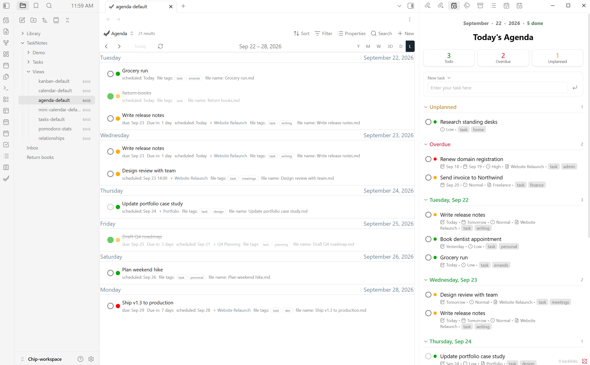

# TaskNotes Agenda Wrapper

A display of all your task notes in a today's agenda window for. It gives you stats, date-grouped, quick task entry, and list for the sidebar or embedded.

<p align="center">
  
</p>

> Requires the [TaskNotes](https://github.com/callumalpass/tasknotes). plugin. This reads your TaskNotes tasks; it does not manage tasks on its own. 

## Features

- **Stat tiles** — Todo, Overdue and Unplanned counts; click one to filter. Today's done count sits in the date line.
- **Date-grouped list** — Unplanned, Overdue, then each upcoming day, all collapsible.
- **Quick entry** — type a title and press Enter, or open the full TaskNotes creator.
- **Interactive** — click a title to open the task, its ring to mark it done.
- **Calendar events** (optional) — ICS, Google and Microsoft events from TaskNotes, interleaved with tasks by time. Click one to create a task or note from it.

## Usage

### As a sidebar pane

- Click the **calendar-clock** ribbon icon, or
- Run the command **"TaskNotes Agenda Wrapper: Open Today's Agenda"**.

The pane opens in the right sidebar. Drag its tab anywhere you like.

### Embedded in a note

Add a code block:

    ```tasknotes-agenda
    ```

Optional settings inside the block:

    ```tasknotes-agenda
    title: This Week
    days: 7
    events: true
    ```

- `title` — the header shown under the date line (default: `Today's Agenda`).
- `days` — how many days ahead to include (default: `14`).
- `events` — `true` / `false` to show or hide TaskNotes calendar events in this block (overrides the plugin setting).


## Settings

| Setting | |
|---|---|
| Open tasks in a new tab | On by default; mod-click always opens a new tab |
| Icons in task metadata | Icons instead of `due:` / `scheduled:` labels |
| Show each task once | Only on its first day, not again on its due day |
| Statuses to exclude | Comma-separated; drops those tasks from the agenda and its counts |
| Show calendar events | Off by default; needs a calendar connected in TaskNotes |
| Hide events that already ended today | Today's finished events drop off; multi-day ones stay |

## How it reads your tasks

It reads TaskNotes' own settings at runtime and falls back to TaskNotes defaults if they can't be read. A task is any note carrying your task tag — or, if you identify tasks by a frontmatter property instead, any note whose property matches the value you set. Archived tasks are left out, along with anything in your excluded folders or your archive folder, so the agenda holds the same notes TaskNotes itself indexes. Dates, status, and priority, projects, and tags come from your configured frontmatter fields. Creating and completing tasks goes through TaskNotes itself, so your creation defaults, natural-language dates and recurring tasks behave exactly as they do there. Calendar events come the same way: this plugin reads the events TaskNotes has already fetched rather than talking to Google or Microsoft itself, so it needs no accounts or keys of its own — and if a TaskNotes update changes how it stores them, events stop appearing while the rest of the agenda carries on working. A task scheduled for a past day that's still open carries into today.

## Installation

### From the community plugins browser

Settings → Community plugins → Browse → search **TaskNotes Agenda Wrapper** → Install → Enable.

### Manually

1. Download `main.js`, `manifest.json`, and `styles.css` from the latest [release](https://github.com/toya-co/tasknotes-agenda-wrapper/releases).
2. Copy them into `<your-vault>/.obsidian/plugins/tasknotes-agenda-wrapper/`.
3. Reload Obsidian → Settings → Community plugins → enable **TaskNotes Agenda Wrapper**.

### Via BRAT

Add `toya-co/tasknotes-agenda-wrapper` as a beta plugin in [BRAT](https://github.com/TfTHacker/obsidian42-brat).

## License

[MIT](LICENSE) © Toyo Co.
